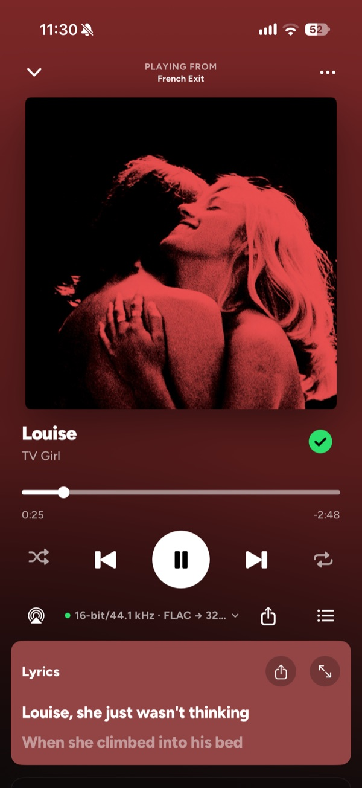
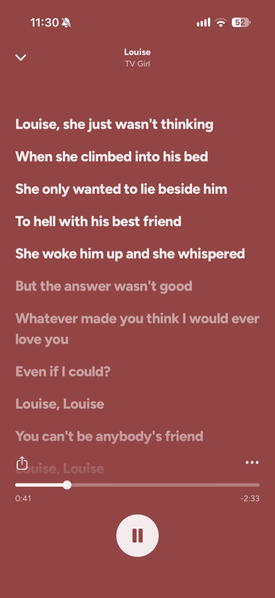
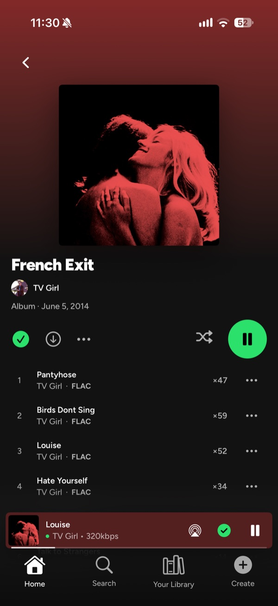
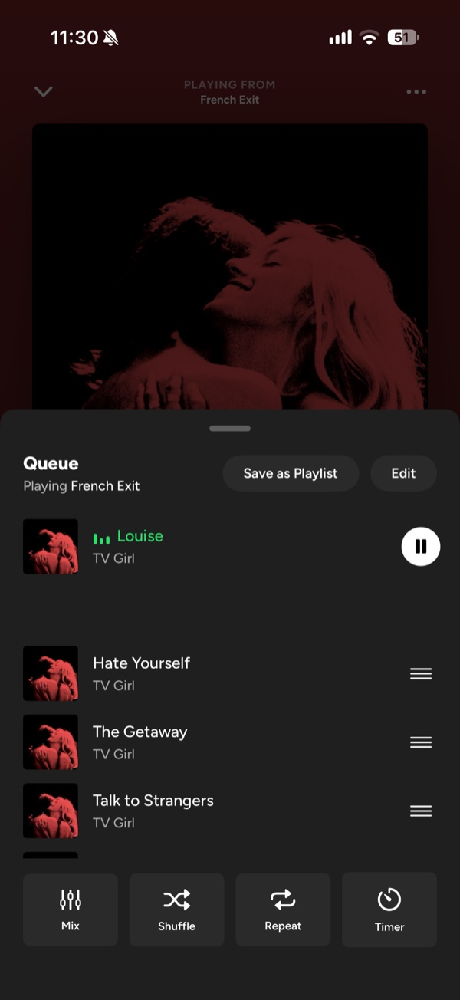

<p align="center">
  
</p>

<h1 align="center">Splynt</h1>

<p align="center">
  A Spotify-style client for your own
  <a href="https://www.navidrome.org/">Navidrome</a> or Subsonic server.
</p>

<p align="center">
  <sub>Splynt is an independent project. It isn't affiliated with or endorsed by Spotify.</sub>
</p>

<p align="center">
  <a href="https://testflight.apple.com/join/UWvEDqQc"><strong>iPhone</strong></a>
  &nbsp;·&nbsp;
  <a href="https://github.com/elijahgronda/Splynt/releases/latest/download/Splynt-Windows.exe"><strong>Windows</strong></a>
  &nbsp;·&nbsp;
  <a href="#install"><strong>Mac</strong></a>
  &nbsp;·&nbsp;
  <a href="https://github.com/elijahgronda/Splynt/releases/latest/download/Splynt-Linux.AppImage"><strong>Linux</strong></a>
  &nbsp;·&nbsp;
  <a href="#install"><strong>Terminal</strong></a>
  &nbsp;·&nbsp;
  <a href="https://discord.gg/kkaZfRpsm"><strong>Discord</strong></a>
</p>

<p align="center">
  
  
  
  
</p>

---

Splynt is a Navidrome client with a really familiar UI. It's on iPhone,
desktop, and now the terminal too.

I've been using it as my main player for a while now, so it's pretty polished.
I put out updates pretty often though, so there are still things I'm ironing
out. If you run into anything, let me know in the
[Discord](https://discord.gg/kkaZfRpsm).

## Install

**iPhone:** join the beta on [TestFlight](https://testflight.apple.com/join/UWvEDqQc).
An App Store release is planned!

**Windows:** download [Splynt-Windows.exe](https://github.com/elijahgronda/Splynt/releases/latest/download/Splynt-Windows.exe) and run it.
It isn't signed yet, so Windows might warn you. Hit **More info**, then **Run anyway**.

**Mac:** download [Apple Silicon](https://github.com/elijahgronda/Splynt/releases/latest/download/Splynt-Mac-Apple-Silicon.dmg) (M1 and
newer) or [Intel](https://github.com/elijahgronda/Splynt/releases/latest/download/Splynt-Mac-Intel.dmg). It isn't signed yet either, so
the first time you open it, go to System Settings, Privacy & Security, and hit
**Open Anyway**.

**Linux:** download the [AppImage](https://github.com/elijahgronda/Splynt/releases/latest/download/Splynt-Linux.AppImage) or the
[.deb](https://github.com/elijahgronda/Splynt/releases/latest/download/Splynt-Linux.deb).

**Terminal:** paste one of these in, then type `splynt`. Run it again any
time to update.

```sh
# Mac and Linux
curl -fsSL https://raw.githubusercontent.com/elijahgronda/Splynt/main/install.sh | sh
```

```powershell
# Windows (PowerShell)
irm https://raw.githubusercontent.com/elijahgronda/Splynt/main/install.ps1 | iex
```

Apple TV and Apple Watch are in progress.

## Features

- **Gapless and crossfade playback.** Albums play straight through, or you can
  fade songs into each other.
- **Audio equalizer.** Ten bands, twelve presets and a preamp. It works on
  everything, streamed or downloaded.
- **Library search AND indexed lyric search.** Splynt indexes your lyrics, so
  you can find a song from just a line you remember.
- **Synced lyrics.** They follow along with the song, under the player or full
  screen.
- **Artist discography pages.** Every release, their popular songs, and how
  many times you've played each one.
- **Daily Mixes based on your listening.** Splynt has its own recommendation
  engine for these. It's not perfect yet, and it can take a little bit to index
  your library before they show up. You can turn the row off if you'd rather
  not have it.
- **Playlist suggestions.** Ten songs that fit the playlist show up at the
  bottom of your playlists. Add one and a new one pops into its spot.
- **Widgets.** One for what's playing and one for your listening stats.
- **Adjustable home feeds.** Pick what shows up on Home.

There's also offline downloads, play counts, a sleep timer, the audio format on
every track, and you can save your queue as a playlist.

## The apps

### iPhone

The iPhone app has the most stuff in it, and it's in beta on
[TestFlight](https://testflight.apple.com/join/UWvEDqQc) right now. It has
everything in the list above.

### Desktop

The desktop app is free and open source, and all of its code is right here.
It's built to work like Spotify on desktop: your library on the left, Home and
search up top, and the player along the bottom. It has the same gapless,
crossfade, equalizer, synced lyrics and discography pages as the iPhone app,
plus listening stats and Splynt Connect so you can pass playback between your
computers.

It's made with Tauri 2, React and Rust. If you want to build it yourself, the
steps are in [SplyntDesktop/README.md](SplyntDesktop/README.md).

### Terminal

There's a terminal version too! It has a sidebar, cover art right in the
terminal, search as you type, gapless and crossfade, the equalizer, a
visualizer, downloads and Offline Mode, and the mouse works everywhere. It
saves your queue to the server, so you can pick up on your phone where you
left off. The one-liner is up in [Install](#install), and everything else is in
[SplyntCLI/README.md](SplyntCLI/README.md).

## Bugs and feature requests

Post them in the [Discord](https://discord.gg/kkaZfRpsm) forums! If it's a
bug, sending your log helps a ton:

- **iPhone:** Settings, About, Export Debug Log
- **Desktop:** Settings, Diagnostics, Show log
- **Terminal:** run `splynt --log` to see where the log is

## Docs

- [Changelog](CHANGELOG.md)
- [Desktop UX spec](docs/desktop/DESKTOP-UX-SPEC.md), how the desktop app is
  supposed to behave
- [Splynt Connect](docs/connect/README.md) and its
  [wire protocol](docs/connect/WIRE-V1.md), how Splynt apps find each other and
  pass playback around on your network

## License

The desktop app and the terminal app are [GPL-3.0 or later](LICENSE). Use
them, change them, share them! If you share a modified version, it has to stay GPL with the source available.

The iPhone, Apple TV and Apple Watch apps are separate and closed source, so
they're not in here and this license doesn't cover them.
